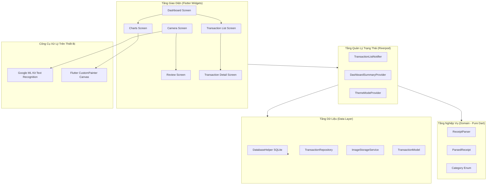

# Quản Lý Chi Tiêu & Nhận Diện Hóa Đơn OCR (Flutter & Dart) 🧾💸

[](https://flutter.dev)
[](https://dart.dev)
[](LICENSE)
[-brightgreen)]()
[]()

Ứng dụng di động quản lý chi tiêu cá nhân thông minh và hoàn toàn ngoại tuyến (offline) trên thiết bị dành cho sinh viên, người đi làm và thủ quỹ câu lạc bộ. Ứng dụng cho phép chụp ảnh hóa đơn siêu thị/cửa hàng tiện lợi, tự động bóc tách **Tổng tiền**, **Tên đơn vị bán lẻ** và **Ngày giao dịch** bằng mô hình Google ML Kit Text Recognition kết hợp bộ phân tích heuristic chuyên biệt cho hóa đơn Việt Nam, cho phép người dùng kiểm tra/chỉnh sửa nhanh, lưu vào cơ sở dữ liệu SQLite cục bộ và trực quan hóa chi tiêu thông qua biểu đồ động vẽ thủ công bằng `CustomPainter` (hoàn toàn không dùng thư viện biểu đồ bên thứ ba).

---

## 📸 Các Tính Năng Nổi Bật

- **⚡ Hoạt Động 100% Ngoại Tuyến (Offline & Riêng Tư)**: Toàn bộ quá trình quét văn bản OCR và bóc tách dữ liệu hóa đơn chạy trực tiếp trên thiết bị (on-device) thông qua Google ML Kit. Không có bất kỳ hình ảnh hay dữ liệu chi tiêu nào bị gửi lên máy chủ từ xa.
- **📸 Màn Hình Camera Viewfinder Tùy Biến**:
  - Khung ngắm định vị hóa đơn trực tiếp với viền mờ xung quanh và 4 góc căn chỉnh nổi bật.
  - Chạm để lấy nét (tap-to-focus) đi kèm hiệu ứng vòng tròn hoạt họa phản hồi trực quan.
  - Bật/tắt đèn flash hỗ trợ chụp thiếu sáng và chuyển đổi ống kính camera trước/sau.
  - Hỗ trợ chọn ảnh hóa đơn có sẵn từ Thư viện ảnh hệ thống.
  - Tự động cắt ảnh (bounding-box crop) đúng theo tỷ lệ khung quét trước khi xử lý OCR.
- **🧠 Bộ Phân Tích Heuristic Chuyên Biệt Cho Hóa Đơn Việt Nam**:
  - Tự động bóc tách tổng tiền với cả dấu chấm và dấu phẩy phân cách hàng nghìn (`150.000 đ`, `1,250,000 VND`).
  - Tự động nhận diện chuỗi siêu thị/cửa hàng tiện lợi quen thuộc tại Việt Nam (`WinMart`, `Bách Hóa Xanh`, `Circle K`, `Highlands Coffee`, `Phúc Long`, `Co.opmart`, `GS25`, `Lotte Mart`,...).
  - Xử lý các định dạng ngày tháng tiếng Việt và quốc tế (`DD/MM/YYYY`, `DD-MM-YYYY`, `DD.MM.YYYY`, `DD/MM/YY`).
  - Lọc bỏ các thông tin rác như mã số thuế (`MST`), số hotline, số điện thoại, địa chỉ cửa hàng.
  - Tự động tính toán điểm mức độ tin cậy (Confidence Score).
- **✏️ Màn Hình Xem Lại & Chỉnh Sửa Trực Quan**:
  - Xem trước ảnh hóa đơn đã cắt với tính năng chạm để phóng to/thu nhỏ (pinch-to-zoom).
  - Biểu mẫu chỉnh sửa đầy đủ: Tên cửa hàng, Số tiền (VND), Ngày tháng, Phân loại danh mục.
  - Đánh giá mức độ tin cậy kèm chỉ dẫn nhanh nếu thông tin cần người dùng xác nhận.
- **📊 Biểu Đồ Thống Kê Canvas Tùy Biến (Không Thư Viện Bên Thứ 3)**:
  - **Biểu đồ Donut**: Lập trình bằng `CustomPainter`, có hiệu ứng quét mượt mà (sweep animation), phân chia rãnh cách cung tròn, đổ bóng glow và tính năng chạm vào từng lát cắt (hit testing) để xem chi tiết.
  - **Biểu đồ Cột theo tuần**: Cột mọc dần từ dưới lên, áp dụng thuật toán làm tròn mốc trục Y thông minh (Nice Number algorithm), chạm vào cột để hiển thị Tooltip nổi chi tiết.
- **💾 Lưu Trữ Dữ Liệu Cục Bộ SQLite**:
  - Lưu trữ giao dịch an toàn với SQLite (`sqflite`), hỗ trợ migration và chỉ mục tối ưu.
  - Tính năng vuốt để xóa (Swipe-to-delete) có thanh thông báo **Hoàn tác (Undo)** nhanh chóng.
  - Tìm kiếm theo tên cửa hàng và lọc chi tiêu theo các Filter Chip danh mục.
- **🎨 Giao Diện Chuẩn Material 3 Hiện Đại**:
  - Hỗ trợ đầy đủ chế độ Sáng (Light Mode) và Tối (Dark Mode).
  - Màu sắc hài hòa, typography thanh lịch và vi chuyển động mượt mà.

---

## 🏛️ Kiến Trúc Hệ Thống (Clean Architecture)

Ứng dụng được xây dựng theo mô hình phân lớp Clean Architecture kết hợp State Management bằng Riverpod:



---

## 📂 Cấu Trúc Thư Mục Dự Án

```
Mini-Project3/
├── lib/
│   ├── main.dart                          # Điểm khởi chạy ứng dụng & khởi tạo SQLite
│   ├── app.dart                           # MaterialApp gốc, chủ đề giao diện & NavigationBar
│   ├── core/
│   │   ├── constants/app_constants.dart   # Hằng số cấu hình & UI key
│   │   ├── theme/app_theme.dart           # Giao diện Material 3 (Light & Dark theme)
│   │   ├── utils/date_utils.dart          # Định dạng ngày tháng tiếng Việt
│   │   ├── utils/vnd_formatter.dart       # Định dạng tiền tệ VND (dấu chấm, rút gọn K/M)
│   │   └── widgets/                       # Widget dùng chung (Loading overlay, Error widget)
│   ├── data/
│   │   ├── database/database_helper.dart  # Cấu hình SQLite, migrations & bảng dữ liệu
│   │   ├── models/transaction_model.dart  # Mô hình dữ liệu & chuyển đổi DB
│   │   ├── repositories/transaction_repository.dart # Kho dữ liệu giao dịch
│   │   └── services/image_storage_service.dart      # Quản lý lưu trữ ảnh & thumbnail
│   ├── domain/
│   │   ├── entities/category.dart         # Enum danh mục kèm icon & màu sắc
│   │   ├── entities/parsed_receipt.dart   # Mô hình kết quả sau khi bóc tách hóa đơn
│   │   └── parser/receipt_parser.dart     # Bộ phân tích heuristic regex thuần Dart
│   └── features/
│       ├── capture/                       # Camera viewfinder, khung quét & cắt ảnh
│       ├── review/                        # Màn hình kiểm tra & chỉnh sửa kết quả OCR
│       ├── dashboard/                     # Tổng quan chi tiêu, thao tác nhanh & gần đây
│       ├── transactions/                  # Danh sách chi tiêu, tìm kiếm, lọc & chi tiết
│       └── charts/                        # Biểu đồ Donut & Bar vẽ bằng CustomPainter
├── test/
│   ├── receipt_parser_test.dart           # 16 unit tests kiểm thử bộ bóc tách hóa đơn
│   ├── vnd_formatter_test.dart            # 7 unit tests kiểm thử định dạng tiền tệ
│   └── widget_test.dart                   # Smoke test điều hướng ứng dụng
├── docs/
│   ├── REPORT.md                          # Báo cáo kỹ thuật chi tiết
│   └── DEMO_SCRIPT.md                     # Kịch bản thuyết trình & quay video demo
├── pubspec.yaml                           # Khai báo thư viện & cấu hình ứng dụng
└── LICENSE                                # Giấy phép mã nguồn mở MIT
```

---

## 🚀 Hướng Dẫn Cài Đặt & Chạy Ứng Dụng

### Yêu Cầu Môi Trường

- **Flutter SDK**: `>= 3.16.0` (đã kiểm thử thành công trên Flutter 3.47.6 / Dart 3.13.5).
- **Android SDK**: `minSdkVersion 21` trở lên.
- **iOS**: iOS 12.0+ (Xcode cấu hình quyền truy cập Camera).

### Các Bước Cài Đặt

1. **Clone repository về máy**:
   ```bash
   git clone https://github.com/your-username/ocr_expense_tracker.git
   cd ocr_expense_tracker
   ```

2. **Cài đặt các gói phụ thuộc (dependencies)**:
   ```bash
   flutter pub get
   ```

3. **Kiểm tra chất lượng mã nguồn (linter)**:
   ```bash
   flutter analyze
   ```
   *(Kết quả mong đợi: `No issues found!`, 0 lỗi, 0 cảnh báo).*

4. **Chạy toàn bộ bộ kiểm thử tự động (unit tests)**:
   ```bash
   flutter test
   ```
   *(Kết quả mong đợi: `All 24 tests passed!`).*

5. **Khởi chạy ứng dụng trên thiết bị thật hoặc máy ảo**:
   ```bash
   flutter run
   ```

### Hướng Dẫn Đóng Gói & Triển Khai Flutter Web (Cloudflare Pages UI Demo)

Để xuất bản bản dựng Web dành cho Cloudflare Pages:
```bash
flutter build web --release
```
* **Thư mục xuất bản (Publish Directory)**: `build/web`
* **Quy tắc điều hướng SPA (Single Page Application)**: Đã cấu hình sẵn file [`web/_redirects`](file:///d:/DaNenTang/Mini-Project3/web/_redirects) với nội dung `/* /index.html 200`.
* **Trải nghiệm Demo trên Web**:
  - Tự động nạp sẵn dữ liệu giao dịch mẫu trải dài tất cả các danh mục (`Food`, `Study`, `Travel`, `Gear`, `Entertainment`, `Other`) giúp hiển thị biểu đồ tròn Donut và biểu đồ cột ngay khi mở app.
  - Tích hợp bộ giả lập quét OCR (Web OCR Simulator) cho phép chọn các mẫu hóa đơn siêu thị Việt Nam (WinMart, Circle K, Highlands Coffee, Bách Hóa Xanh, Phúc Long) hoặc dán văn bản hóa đơn tùy ý để kiểm thử bộ phân tích `ReceiptParser`.
  - Cơ sở dữ liệu chạy In-Memory an toàn không phụ thuộc SQLite/native I/O.

---

## 🧪 Chi Tiết Bộ Kiểm Thử Tự Động (Unit Tests)

Bộ kiểm thử bao gồm **27 bài kiểm thử** tự động bao phủ toàn diện:
- `test/in_memory_repository_test.dart` (3 tests):
  - Khởi tạo và nạp dữ liệu mẫu web trên toàn bộ danh mục chi tiêu.
  - Kiểm thử CRUD (thêm, đọc, cập nhật, xóa) trong bộ nhớ.
  - Kiểm thử các hàm thống kê `sumByCategory`, `sumByDay`, `totalAmount`.
- `test/receipt_parser_test.dart` (16 tests):
  - Xử lý hóa đơn trống trả về null và độ tin cậy 0%.
  - Hóa đơn WinMart với số tiền phân cách dấu chấm (`77.000 đ`).
  - Hóa đơn Bách Hóa Xanh có dấu và không dấu tiếng Việt.
  - Hóa đơn Circle K có từ khóa `THANH TOÁN` trên cùng dòng.
  - Trường hợp nhãn từ khóa và số tiền bị ngắt làm 2 dòng liên tiếp.
  - Hóa đơn tiếng Anh với dấu phẩy hàng nghìn (`TOTAL: 140,000 VND`).
  - Giải thuật tìm số tiền lớn nhất ở nửa dưới hóa đơn khi không có từ khóa rõ ràng.
  - Nhận diện chuỗi bán lẻ nổi tiếng theo thứ tự ưu tiên độ dài chuỗi ký tự.
  - Loại bỏ hoàn toàn mã số thuế (`MST`), số hotline, số điện thoại, địa chỉ.
  - Định dạng năm 2 chữ số (`24` → `2024`) và ngày phân cách dấu chấm (`18.03.2024`).
  - Xử lý số tiền lớn (`14.500.000 VND`).
  - Tính điểm trọng số độ tin cậy (Confidence Score).
  - Khả năng chống nhiễu trước các ký tự lạ và đường viền in lỗi của máy in nhiệt.
- `test/vnd_formatter_test.dart` (7 tests):
  - Định dạng mức 0 VND.
  - Phân cách hàng nghìn và hàng triệu bằng dấu chấm chuẩn Việt Nam.
  - Cơ chế làm tròn số thập phân.
  - Định dạng rút gọn cho biểu đồ (`50K ₫`, `1.5M ₫`, `2M ₫`).
- `test/widget_test.dart`:
  - Smoke test xác nhận cấu trúc điều hướng và thanh điều hướng dưới đáy.

---

## 📄 Tài Liệu Bàn Giao Kèm Theo

- [Báo Cáo Kỹ Thuật Dự Án (docs/REPORT.md)](docs/REPORT.md): Báo cáo kỹ thuật chi tiết trình bày phân tích bài toán, kiến trúc Clean Architecture, giải thuật bóc tách heuristic, kỹ thuật vẽ Canvas CustomPainter, kiểm thử và lộ trình phát triển.
- [Kịch Bản Thuyết Trình Demo (docs/DEMO_SCRIPT.md)](docs/DEMO_SCRIPT.md): Kịch bản dẫn dắt từng cảnh (3 - 5 phút) chi tiết phục vụ quay video hoặc trình bày trực tiếp trước hội đồng chấm thi.

---

## 📜 Giấy Phép (License)

Dự án được phân phối dưới giấy phép mã nguồn mở **MIT License** - xem chi tiết tại file [LICENSE](LICENSE).
