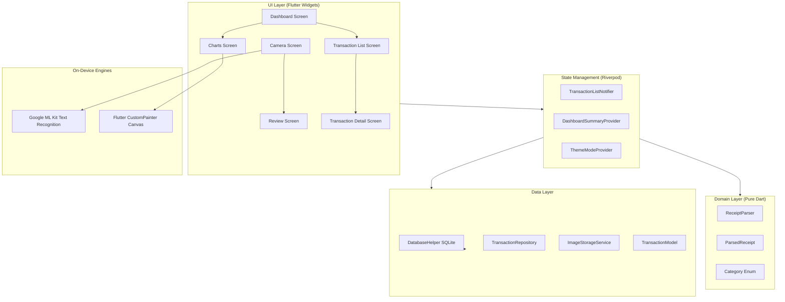

# OCR Expense Tracker & Receipt Parser 🧾💸

[](https://flutter.dev)
[](https://dart.dev)
[](LICENSE)
[-brightgreen)]()
[]()

An offline, on-device mobile personal finance application built with Flutter & Dart for students, freelancers, and club treasurers. The app allows users to photograph physical supermarket receipts/invoices or bills, automatically extracts total amounts, merchant names, and transaction dates via Google ML Kit Text Recognition with specialized Vietnamese heuristics, facilitates fast user review, persists transactions into a local SQLite database, and presents animated custom canvas charts (zero third-party chart libraries).

---

## 📸 Core Features

- **⚡ 100% Offline & Private**: All OCR text recognition and receipt parsing run directly on the device using Google ML Kit. No receipt data or image is ever uploaded to a remote server.
- **📸 Custom Camera Viewfinder**:
  - Real-time camera preview with a framed receipt scan overlay (dimmed borders and corner brackets).
  - Tap-to-focus with animated ripple ring indicator.
  - Flashlight/torch toggle and camera lens switcher.
  - Import receipts directly from system gallery.
  - Automatic on-device bounding-box image cropping to receipt borders.
- **🧠 Vietnamese-Specialized Receipt Parser**:
  - Regex & heuristic extraction for total amounts with dot/comma thousand separators (`150.000 đ`, `1,250,000 VND`).
  - Known Vietnamese retail & convenience store brand matching (`WinMart`, `Bách Hóa Xanh`, `Circle K`, `Highlands Coffee`, `Phúc Long`, `Co.opmart`, `GS25`, `Lotte Mart`, etc.).
  - Vietnamese and English date parsing (`DD/MM/YYYY`, `DD-MM-YYYY`, `DD.MM.YYYY`, `DD/MM/YY`).
  - Strict filtering out of tax codes (`MST`), hotlines, phone numbers, and addresses.
  - Heuristic confidence score scoring.
- **✏️ Interactive Review & Edit Screen**:
  - Side-by-side cropped receipt image preview with interactive zoom dialog.
  - Editable form fields for Merchant, Amount, Date, and Category.
  - Confidence indicators with quick-fix assistance.
- **📊 Custom Canvas Analytics (Zero 3rd-Party Chart Libraries)**:
  - **Donut Chart**: Built with `CustomPainter`, featuring sweep animations, category color coding, and interactive touch segment highlighting.
  - **Bar Chart**: Weekly spending visualization with animated growing bars, dynamic nice Y-axis ticks, and tap tooltips.
- **💾 Local SQLite Database**:
  - Fast, ACID-compliant local database storing amounts, merchants, dates, categories, notes, image paths, and timestamps.
  - Swipe-to-delete with undo SnackBar.
  - Category filtering and merchant search.
- **🎨 Modern Material 3 UI**:
  - Harmonious light and dark modes.
  - Smooth micro-animations and typography.

---

## 🏛️ Architecture Overview

The app follows a Clean Architecture layered model with Riverpod state management:



---

## 📂 Project Structure

```
Mini-Project3/
├── lib/
│   ├── main.dart                          # Application entrypoint & DB initialization
│   ├── app.dart                           # Root MaterialApp, theme & NavigationBar shell
│   ├── core/
│   │   ├── constants/app_constants.dart   # App configurations & UI keys
│   │   ├── theme/app_theme.dart           # Material 3 light & dark themes
│   │   ├── utils/date_utils.dart          # Date formatters (VN format)
│   │   ├── utils/vnd_formatter.dart       # Currency formatting & compact format
│   │   └── widgets/                       # Reusable loading overlay & error widgets
│   ├── data/
│   │   ├── database/database_helper.dart  # SQLite schema, migrations & CRUD
│   │   ├── models/transaction_model.dart  # Data entity & database mapping
│   │   ├── repositories/transaction_repository.dart # Transaction repository
│   │   └── services/image_storage_service.dart      # File storage & thumbnails
│   ├── domain/
│   │   ├── entities/category.dart         # Category enum with icons & colors
│   │   ├── entities/parsed_receipt.dart   # Structured parser output data model
│   │   └── parser/receipt_parser.dart     # Pure-Dart regex & heuristic OCR parser
│   └── features/
│       ├── capture/                       # Camera viewfinder, overlays & crop
│       ├── review/                        # OCR result verification & editing
│       ├── dashboard/                     # Metrics, quick actions & recents
│       ├── transactions/                  # Full history, filters & detail/edit
│       └── charts/                        # CustomPainter donut & bar charts
├── test/
│   ├── receipt_parser_test.dart           # 16 unit tests for OCR parsing
│   ├── vnd_formatter_test.dart            # 7 unit tests for currency formatting
│   └── widget_test.dart                   # Smoke & navigation tests
├── docs/
│   ├── REPORT.md                          # Comprehensive technical project report
│   └── DEMO_SCRIPT.md                     # Step-by-step presentation & demo script
├── pubspec.yaml                           # Dependencies & assets configuration
└── LICENSE                                # MIT License
```

---

## 🚀 Getting Started

### Prerequisites

- **Flutter SDK**: `>= 3.16.0` (tested on Flutter 3.47.6 / Dart 3.13.5)
- **Android SDK**: `minSdkVersion 21` or higher
- **iOS**: iOS 12.0+ (Xcode with camera permissions)

### Installation

1. **Clone the repository**:
   ```bash
   git clone https://github.com/your-username/ocr_expense_tracker.git
   cd ocr_expense_tracker
   ```

2. **Install dependencies**:
   ```bash
   flutter pub get
   ```

3. **Verify static analysis**:
   ```bash
   flutter analyze
   ```
   *(Expected output: No issues found! 0 warnings)*

4. **Run test suite**:
   ```bash
   flutter test
   ```
   *(Expected output: All 24 tests passed!)*

5. **Run on connected device or simulator**:
   ```bash
   flutter run
   ```

### Building Release APK

To create an Android APK for installation:
```bash
flutter build apk --release
```
The output file will be generated at `build/app/outputs/flutter-apk/app-release.apk`.

---

## 🧪 Unit Testing Details

The test suite thoroughly covers all parser heuristics and formatting logic:
- `test/receipt_parser_test.dart`:
  - Empty receipt handling and fallback zero confidence
  - WinMart receipts with dots as thousand separators (`77.000 đ`)
  - Bách Hóa Xanh receipts with unaccented and accented text
  - Circle K receipts with inline `THANH TOÁN`
  - Split line amounts where keyword and value are separated
  - English receipts with comma separators (`TOTAL: 140,000 VND`)
  - Fallback largest amount heuristic in lower receipt half
  - Retail chain brand recognition with length-prioritized matching
  - Tax code (`MST`), phone, hotline, and address exclusion
  - Two-digit year (`24` → `2024`) and dot date format (`18.03.2024`)
  - Large amount processing (`14.500.000 VND`)
  - Confidence score calculations
  - OCR symbol noise resilience
- `test/vnd_formatter_test.dart`:
  - 0 VND formatting
  - Thousands and millions dot separation
  - Rounding logic for double values
  - Compact format labels (`50K ₫`, `1.5M ₫`, `2M ₫`)
- `test/widget_test.dart`:
  - Smoke tests for the application shell and navigation destinations.

---

## 📄 Documentation

- [Technical Report (docs/REPORT.md)](docs/REPORT.md): In-depth report covering architecture, OCR algorithm design, canvas performance, benchmark evaluations, and future roadmap.
- [Demo Walkthrough Script (docs/DEMO_SCRIPT.md)](docs/DEMO_SCRIPT.md): Step-by-step presentation script designed for 3-5 minute live evaluations and video demonstrations.

---

## 📜 License

This project is licensed under the MIT License - see the [LICENSE](LICENSE) file for details.
